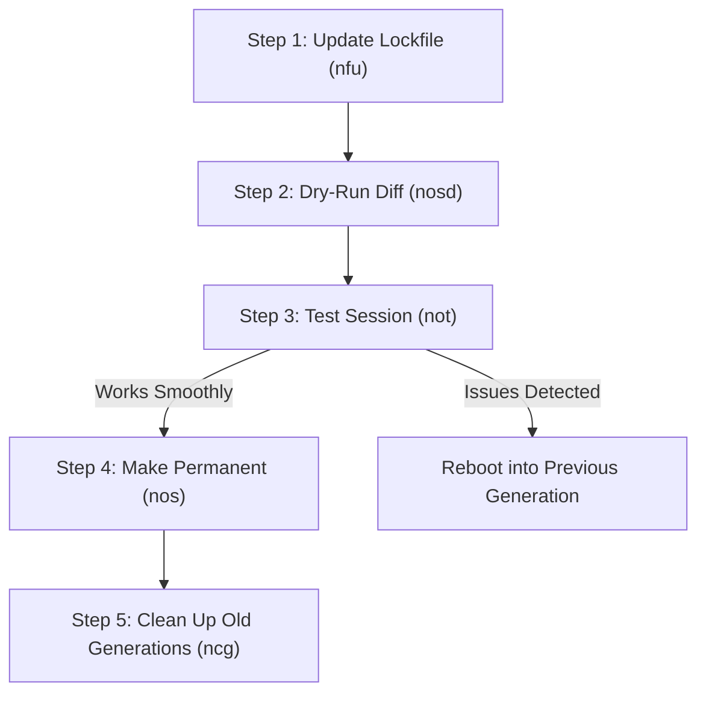

# NixOS Workflow & Operations Guide

A practical reference guide for day-to-day operations, updates, and package management in this dotfiles repository.

---

## 1. Adding & Managing Packages

### A. Try Before Installing (Ad-Hoc Testing)
Before committing a package to your configuration, you can test or run it without permanently installing it:

* **Search for packages in Nixpkgs**:
  ```bash
  ns <query>            # Fast, colorful search via nh (e.g. ns ripgrep)
  nsp <query>           # Official Nix search CLI (e.g. nsp btop)
  nso <query>           # Search NixOS / Home Manager options via manix
  ```
* **Launch an ephemeral shell with a package**:
  ```bash
  nsh <pkg>             # Temporary environment (e.g. nsh jq iotop)
  ```
* **Run a single binary once**:
  ```bash
  nrn <pkg>             # Execute and discard (e.g. nrn cowsay "hello")
  ```

### B. Installing Permanently
Decide where the package belongs:
1. **User Tools & Desktop Apps** &rarr; Add to [`home/users/cipher/default.nix`](file:///home/cipher/.dotfiles/home/users/cipher/default.nix) in `home.packages`.
2. **System Daemons, Drivers, Core CLI** &rarr; Add to [`hosts/serval/packages.nix`](file:///home/cipher/.dotfiles/hosts/serval/packages.nix) in `environment.systemPackages`.

### C. Applying Package Changes
Because Home Manager is integrated directly into your NixOS flake, rebuild both system and user profiles in one command:
```bash
nos                     # nh os switch (rebuilds & activates)
```
> **Tip**: Run `nosd` first (`nh os switch --dry`) to preview downloads, compilations, and package size diffs.

---

## 2. Modifying Dotfiles & Configuration

### A. Quick Editor Shortcuts
Jump directly to frequently modified configuration files from anywhere:

| Alias | Target File | Description |
| :--- | :--- | :--- |
| `vch` | [`~/.config/hypr/hyprland.lua`](file:///home/cipher/.config/hypr/hyprland.lua) | Hyprland Lua desktop config |
| `vcn` | [`~/.config/noctalia/config.toml`](file:///home/cipher/.config/noctalia/config.toml) | Noctalia shell & bar settings |
| `vds` | [`~/.dotfiles/home/common/shell.nix`](file:///home/cipher/.dotfiles/home/common/shell.nix) | Shell aliases, bash & readline options |
| `vdh` | [`~/.dotfiles/home/users/cipher/default.nix`](file:///home/cipher/.dotfiles/home/users/cipher/default.nix) | User packages, programs, and stylix overrides |
| `vdc` | [`~/.dotfiles/hosts/serval/default.nix`](file:///home/cipher/.dotfiles/hosts/serval/default.nix) | System hardware, services, kernel & GPU |
| `vdp` | [`~/.dotfiles/hosts/serval/packages.nix`](file:///home/cipher/.dotfiles/hosts/serval/packages.nix) | System-wide package list |
| `vdn` | [`~/.dotfiles/modules/home/editors/nvf.nix`](file:///home/cipher/.dotfiles/modules/home/editors/nvf.nix) | Neovim (`nvf`) configuration |
| `vdf` | [`~/.dotfiles/flake.nix`](file:///home/cipher/.dotfiles/flake.nix) | Flake inputs, modules, and outputs |

### B. Directory Navigation Shortcuts
* `cdd` / `tfd` &rarr; Jump to or open `~/.dotfiles/` in Yazi
* `cc` / `tfc` &rarr; Jump to or open `~/.config/` in Yazi
* `ck` / `ftk` &rarr; Jump to or open `~/Documents/my-knowledge-base/` in Yazi

### C. Applying Configuration Changes
* **Standard switch**:
  ```bash
  nos                   # nh os switch (rebuild & activate)
  ```
* **Test in current session only** (does not create boot menu entry):
  ```bash
  not                   # nh os test
  ```
* **Continuous live reload** (watches directory with `entr`):
  ```bash
  enr                   # Auto-rebuilds system whenever any file in ~/.dotfiles changes
  ```

---

## 3. Major System Updates (Kernel, Flakes, Nixpkgs)

When doing major updates (e.g. updating flake inputs, Linux CachyOS kernel, or Nixpkgs channel):

### Recommended Safe Update Workflow



1. **Update Flake Lockfile**:
   ```bash
   nfu                  # nix flake update --flake ~/.dotfiles
   ```
2. **Review Changes (Dry-Run)**:
   ```bash
   nosd                 # nh os switch --dry (inspect package additions, removals, diffs)
   ```
3. **Test in Current Session**:
   ```bash
   not                  # nh os test (activates new build without changing bootloader)
   ```
   *If anything is broken, simply reboot and your system will boot into the previous working generation.*
4. **Make It Permanent**:
   ```bash
   nos                  # nh os switch (sets as default boot entry)
   ```
   *(Alternative single-shot shortcut: `nuo` updates inputs and switches in one step).*
5. **Inspect & Clean (Post-Update Maintenance)**:
   * View all system generations:
     ```bash
     ngen               # nixos-rebuild list-generations
     ```
   * Once you have verified stability over several days, clean up old generations to free disk space:
     ```bash
     ncg                # nh clean all
     ```

---

## 4. Rollback & Recovery Procedures

If an update or configuration change causes issues:

1. **Immediate Session Rollback**:
   Reboot your machine. At the systemd-boot menu, select the previous generation.
2. **Reverting Git Configuration**:
   ```bash
   cdd
   git status
   git checkout <file>  # or: git restore .
   nos                  # rebuild from clean state
   ```
3. **Inspecting Generation History**:
   ```bash
   ngen                 # List NixOS system generations
   nhgen                # List Home Manager user generations
   ```

---

## 5. Quick Alias Cheat Sheet

| Category | Alias | Command | Purpose |
| :--- | :--- | :--- | :--- |
| **Rebuild** | `nos` / `nr` | `nh os switch` | Rebuild & switch NixOS + Home Manager |
| | `not` | `nh os test` | Test rebuild in current session |
| | `nob` | `nh os boot` | Build and add to boot menu only |
| | `nosd` | `nh os switch --dry` | Dry-run rebuild to inspect diffs |
| | `nhs` / `nu` | `nh home switch` | Home Manager switch shortcut |
| | `enr` | `entr ... nixos-rebuild` | Watch dotfiles and rebuild on save |
| **Updates** | `nfu` | `nix flake update` | Update `flake.lock` inputs |
| | `nuo` | `nh os switch --update` | Update inputs + rebuild system in 1 step |
| | `nhu` | `nh home switch --update` | Update inputs + rebuild Home Manager |
| **Search** | `ns` | `nh search` | Fast local search for Nix packages |
| | `nsp` | `nix search nixpkgs` | Flake search across Nixpkgs |
| | `nso` | `manix` | Search NixOS & Home Manager options |
| **Ad-Hoc** | `nsh` | `nix shell nixpkgs#` | Ephemeral package shell (`nsh jq`) |
| | `nrn` | `nix run nixpkgs#` | Ephemeral binary run (`nrn cowsay`) |
| **Clean** | `ncg` | `nh clean all` | Garbage collect old generations |
| | `ncgd` | `nh clean all --dry` | Preview garbage collection savings |
| | `ngen` | `nixos-rebuild list-generations` | List system generations |
| **Hardware** | `kb-red` | `kb-color FF0000 50%` | Set keyboard backlight to red |
| | `kb-blue` | `kb-color 0000FF 50%` | Set keyboard backlight to blue |
| | `kb-off` | `brightnessctl ... 0%` | Turn keyboard backlight off |
